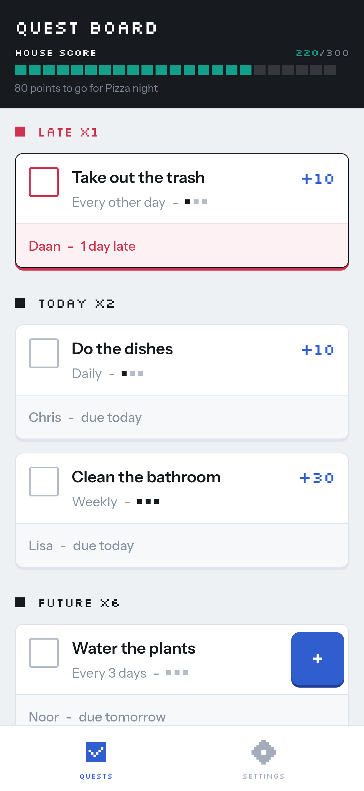
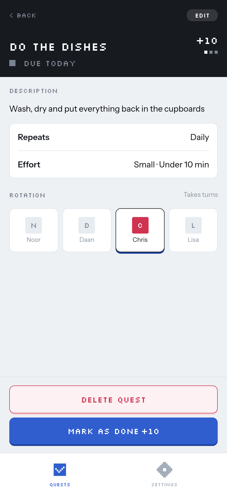
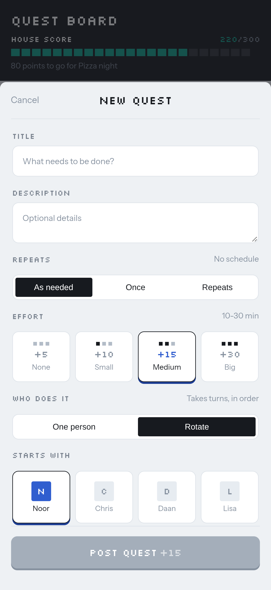
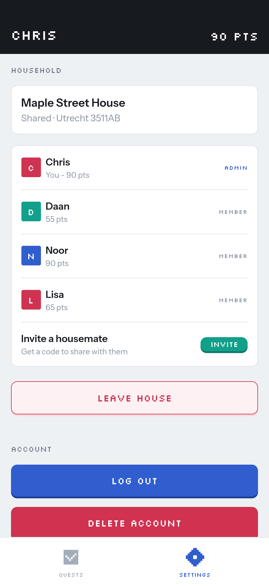

# ChoreQuest frontend

Web app for ChoreQuest, built with React, TypeScript and Vite. The API lives in
[chorequest-backend](https://github.com/terridb/chorequest-backend).

ChoreQuest turns household chores into quests. Housemates take turns on recurring tasks, earn points for every quest
they complete and work together towards a shared house goal.

Live at [chorequest-g3c2.onrender.com](https://chorequest-g3c2.onrender.com).

<p>
  
  
  
  
</p>

## Local setup

Requires Node.js 22 or newer.

1. Start the backend and database with `docker compose up` in the backend repository. The API runs on
   `http://localhost:8080`.
2. Install dependencies and create your `.env`:
   ```bash
   npm install
   cp .env.example .env
   ```
3. Fill in `.env`:

   | Variable               | Value                                                     |
   |------------------------|-----------------------------------------------------------|
   | `VITE_API_BASE_URL`    | `http://localhost:8080`                                   |
   | `VITE_AUTH0_DOMAIN`    | `chore-quest.eu.auth0.com`                                |
   | `VITE_AUTH0_CLIENT_ID` | Client ID of the SPA application in the Auth0 dashboard   |
   | `VITE_AUTH0_AUDIENCE`  | `https://chorequest-api`                                  |

4. Start the dev server with `npm run dev` and open `http://localhost:5173`.

## Scripts

| Command           | Description                                       |
|-------------------|---------------------------------------------------|
| `npm run dev`     | Dev server with hot reload                        |
| `npm run build`   | Type checks and builds into `dist`                |
| `npm run preview` | Serves the production build locally               |
| `npm run lint`    | Runs ESLint                                       |

To only type check, use `npx tsc -b --noEmit`. Plain `tsc --noEmit` checks nothing, because the project uses
TypeScript project references.

## Workflow

- Every change goes through a pull request on a branch named after the type of change (`feature/...`, `fix/...`, `chore/...` etc.), and CI lints and builds it.
- Commits follow Conventional Commits. release-please uses them to write the changelog and version releases.
- Unfinished features ship behind flags in `src/config/features.ts`, so `main` is always releasable.

## Project structure

```
src/
├── api/          Axios client
├── auth/         Auth0 provider, route guards and current user hooks
├── components/   Feature components and shared UI
├── config/       Feature flags
├── hooks/        TanStack Query hooks
├── pages/        One folder per route
├── types/        Types matching the backend DTOs
└── utils/        Helpers
```

## Auth0

Tenant `chore-quest.eu.auth0.com`, API `https://chorequest-api`. Every URL the app runs on (localhost and each deployed
environment) must be listed in the SPA application under Allowed Callback URLs, Allowed Logout URLs and Allowed Web
Origins. The API needs 'Allow Offline Access' enabled, otherwise no refresh tokens are issued and users lose their
session once the access token expires.
